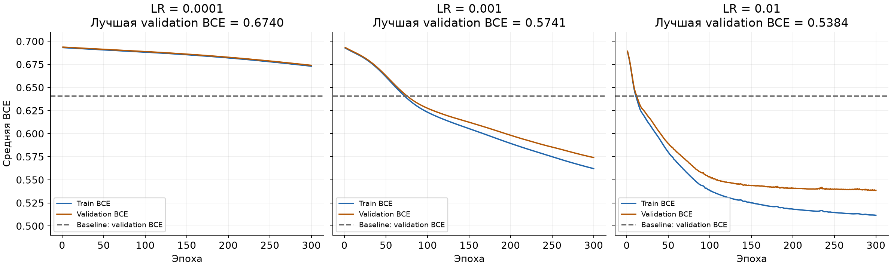
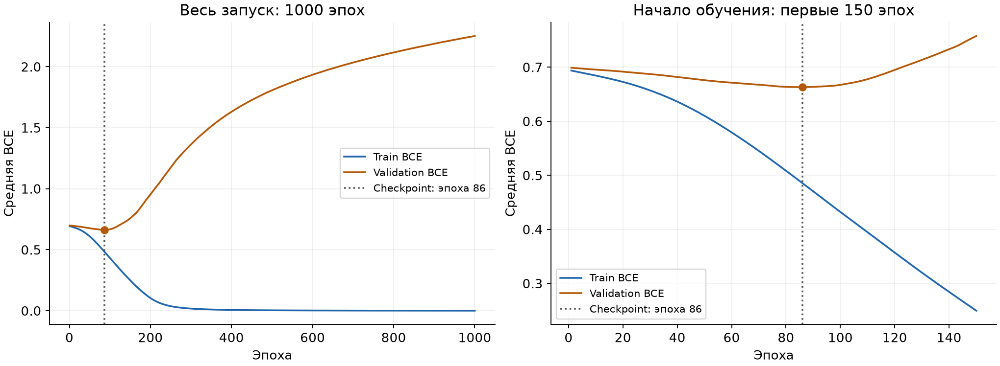

# Neural Network Training Diagnostics

A practical deep learning project on the HIGGS dataset: reproduce training problems, compare controlled configurations, and explain the results with learning curves and classification metrics.

## Models and experiments

- Logistic regression baseline.
- A PyTorch multilayer classifier: 28 → 32 → ReLU → 16 → ReLU → 1 (1,473 parameters).
- Binary cross-entropy loss, full-batch Adam, and checkpoint selection by validation BCE.
- Overfitting on a small training subset and insufficient training progress with a small learning rate.
- A controlled comparison of learning rates 0.0001, 0.001, and 0.01 with the same data, seed and 300-update budget.
- NumPy checkpoints containing model parameters, scaler values, settings and loss histories.

## Results

The November 1 experiment used 100,000 training events and proportional validation/test subsets. Configuration selection used validation BCE; the selected network and baseline were evaluated on the same 21,429 test events.

| Model | Test BCE ↓ | Accuracy ↑ | F1 ↑ | ROC-AUC ↑ |
|---|---:|---:|---:|---:|
| Logistic regression | 0.6431 | 63.95% | 0.6837 | 0.6788 |
| Neural network, lr=0.01 | 0.5368 | 72.57% | 0.7404 | 0.8031 |

These results concern one split and seed. The test set had been inspected earlier in the project's history; this is not an untouched-holdout claim. See the [full Russian report](reports/2026-11-01/report_ru.md) for methods, limitations, hypotheses, metrics and evidence.





## Run locally

Python 3.10 or newer is recommended.

```bash
python3 -m venv .venv
source .venv/bin/activate
python -m pip install -r requirements.txt
```

Download the [HIGGS dataset from UCI](https://archive.ics.uci.edu/dataset/280/higgs). Each event has one binary target and 28 numerical features. The data describe simulated particle-collision events.

Extract the downloaded CSV to `data/raw/HIGGS.csv`, then run:

```bash
mkdir -p data/raw data/processed
python src/data.py
python main.py
```

The full dataset has 11 million rows and requires substantial RAM. The CSV conversion currently loads rows into Python lists before writing NumPy arrays. For an initial run, use a smaller CSV sample. Existing full-data NPZ files can be placed at `data/processed/higgs.npz`, with keys `X` and `Y`.

The interactive menu supports loading data and choosing a training size, fitting the baseline, training the neural network, and evaluating saved network/baseline pairs. The initial split is stratified 70/15/15 with seed 12. Smaller training selections use proportional prefixes of validation/test; scaling is fitted only on the selected training data. Model selection should use validation results.

The program uses Apple MPS when available and otherwise CPU.

## Files

- `main.py`: menu, data selection and metric logging.
- `src/data.py`: CSV → NumPy conversion.
- `src/logistic_regression.py`: baseline training and evaluation.
- `src/neural_network.py`: network training, checkpoints and evaluation.
- `src/plots.py`: loss curves, confusion matrices and ROC curves.
- `data/weights/`: saved model checkpoints.
- `img/`: generated plots.
- `reports/2026-11-01/`: experiment report, evidence and reproducibility scripts.

Raw/processed datasets, the local experiment data slice, virtual environments and IDE files are excluded from version control. Some report scripts expect these local data files to reproduce the measurements.
