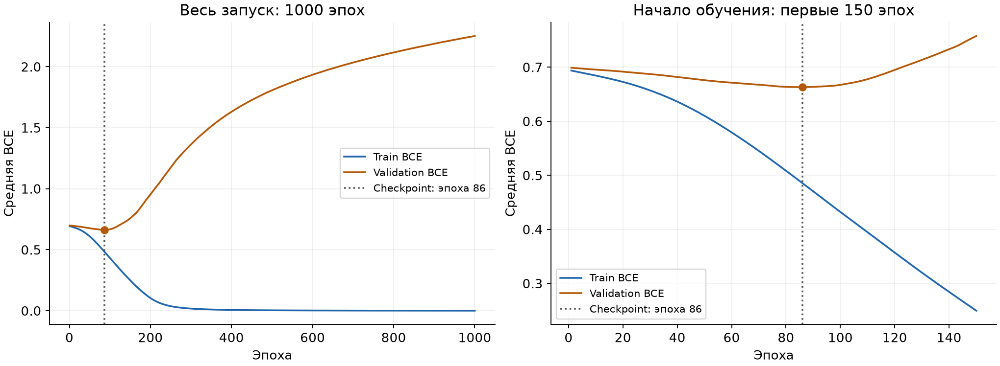
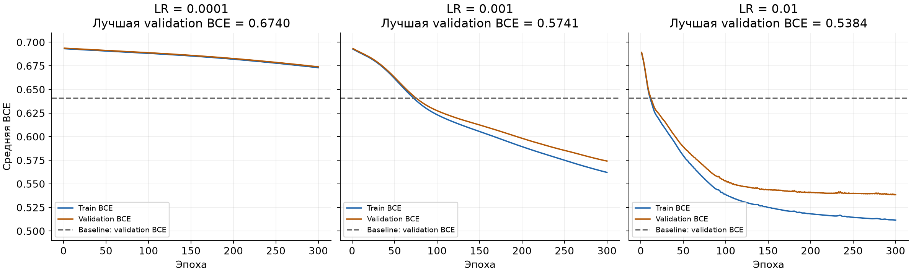
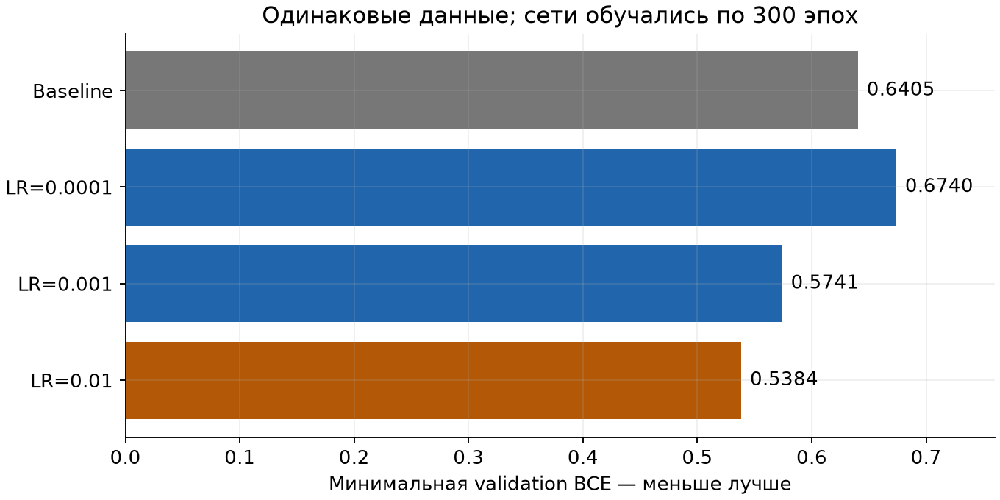
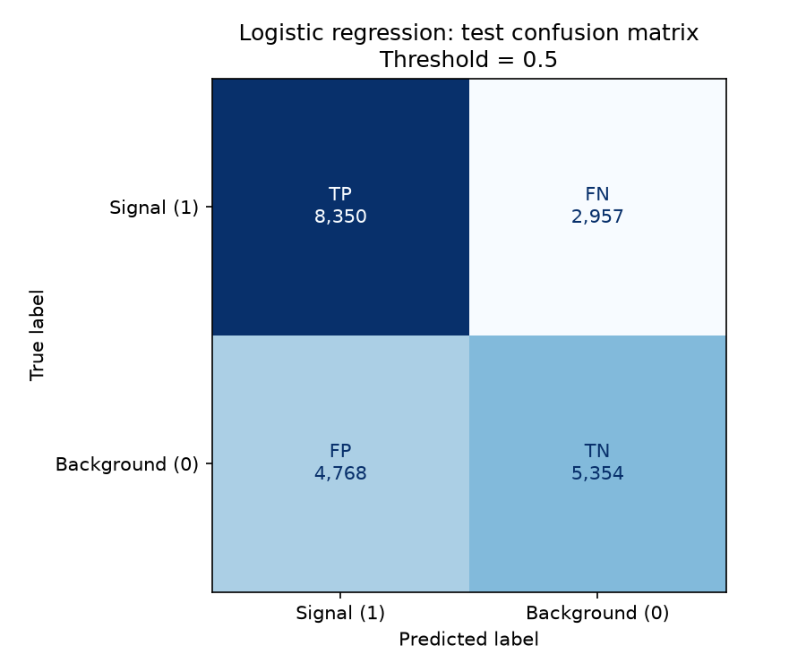
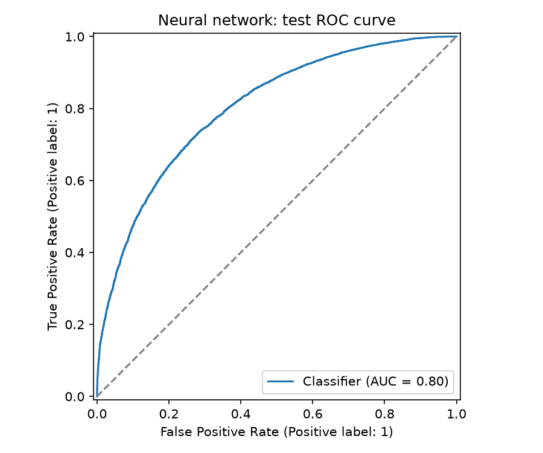
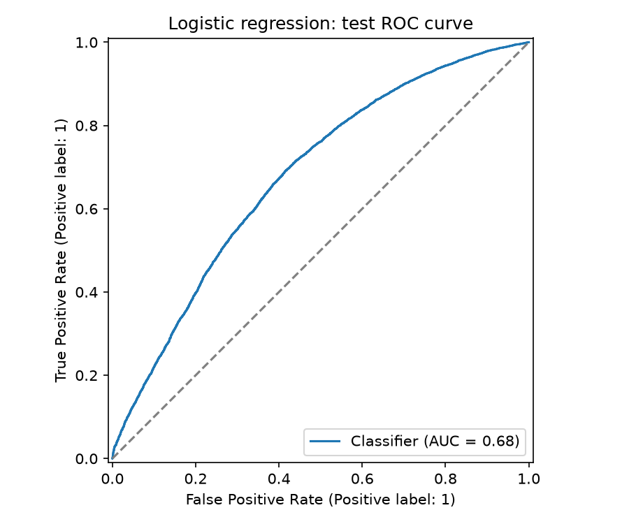

# Project 1. Diagnosing neural network training

HIGGS · отчёт по экспериментам · 1 ноября 2026 года

## Что получилось

Показаны две проблемы: переобучение на 300 train-примерах и недостаточное обучение при маленьком learning rate за фиксированный бюджет. В малом опыте возврат к эпохе 86 уменьшил validation BCE с 2.2518 до 0.6632. Это улучшение относительно последних весов, но не победа над baseline: у логистической регрессии validation BCE 0.6624.

В контролируемом сравнении на 100 000 train-примерах лучший из трёх learning rate — 0.01: validation BCE 0.5384, F1 0.7366. После выбора по validation сеть получила test accuracy 72.57%, baseline — 63.95%; разница 8.62 процентного пункта. Вывод ограничен этим разбиением, seed=12 и бюджетом 300 эпох.

## 1. Задача, данные и правила сравнения

Задача — бинарная классификация событий HIGGS по 28 признакам: класс 1 — signal, класс 0 — background. Baseline — логистическая регрессия. Основная модель — многослойная сеть 28 → 32 → ReLU → 16 → ReLU → 1. В сети 1473 обучаемых параметра. Последний выход — логит; для метрик он преобразуется sigmoid в вероятность класса 1.

Весь исходный набор содержит 11 000 000 событий. Первое разбиение train/validation/test — 70/15/15 со стратификацией и seed=12. Затем текущая программа берёт первые rows train-строк и пропорциональные срезы validation/test. Эти уменьшенные срезы не стратифицируются повторно. Все выбранные значения проверены на конечность; в каждом разделе присутствуют оба класса.

| Опыт | Train | Validation | Test | Класс 1: train / val / test |
| --- | --- | --- | --- | --- |
| Малый набор | 300 | 64 | 64 | 156 / 33 / 30 |
| Сравнение LR | 100 000 | 21 429 | 21 429 | 53 011 / 11 281 / 11 307 |

StandardScaler обучается только на выбранном train. К validation/test применяются его сохранённые средние и масштабы. Baseline и сети одного размера получают одинаковые строки. Для сравнения LR совпадение scaler между запусками дополнительно проверяется. Малый и большой опыты используют разные validation-наборы: их числа нельзя считать чистым эффектом увеличения train.

Сеть обучается full-batch Adam: одна эпоха — одно обновление на всём train. Seed модели — 12; dropout и weight decay отсутствуют. Baseline: LogisticRegression(max_iter=1000, random_state=12), стандартный L-BFGS и регуляризация. Его max_iter — не число эпох нейросети.

Главный критерий выбора — минимальная validation BCE. BCE измеряет ошибку вероятностей: меньше лучше. Accuracy показывает долю верных классов; precision, recall и F1 относятся к положительному классу 1 при пороге 0.5; ROC-AUC оценивает ранжирование вероятностей. Все показатели считаются для одного выбранного checkpoint, а не для разных лучших эпох по каждой метрике.

## 2. Переобучение на маленьком наборе

Источник этого опыта — запуск пользователя и его сохранённые NPZ, обучение повторно не запускалось. Настройки: rows=300, LR=0.001, 1000 эпох, seed=12. Объяснение ниже ретроспективное: результат уже был известен из присланного лога. Нельзя представлять его как гипотезу, впервые записанную до этого запуска.

Гипотеза: при длительном обучении на маленьком наборе сеть подстраивается под особенности 300 примеров, которые не помогают новым событиям. Ожидаемый признак — train loss продолжает снижаться, а validation loss после минимума растёт. Отсутствие регуляризации и малый train делают такое объяснение правдоподобным, но эксперимент не выделяет вклад каждой причины отдельно.

| Состояние сети | Эпоха | Train BCE | Validation BCE |
| --- | --- | --- | --- |
| Лучший checkpoint | 86 | 0.4857 | 0.6632 |
| Конец обучения | 1000 | 0.0006 | 2.2518 |

Рисунок 1. Train BCE продолжает снижаться, а validation BCE после эпохи 86 растёт. Справа — увеличение начала того же запуска, не второй эксперимент.

Измеренное исправление: после всех 1000 эпох код загрузил веса эпохи 86, выбранные по минимальной validation BCE. Ошибка validation уменьшилась на 1.5885, с 2.2518 до 0.6632. Механизм исправления — отказ от последних, переобученных весов в пользу более раннего checkpoint.

Это не early stopping: обучение не прекращалось на эпохе 86. Восстановление уменьшает validation loss относительно последней эпохи, но само по себе не доказывает улучшение на независимых данных: checkpoint выбран именно по validation. Последние веса не сохранены, поэтому финальные F1/accuracy для эпохи 1000 здесь не выдумываются.

| Модель, 300 train | Validation BCE | Accuracy | F1 | ROC-AUC |
| --- | --- | --- | --- | --- |
| Логистическая регрессия | 0.6624 | 60.94% | 0.6154 | 0.6784 |
| Сеть, checkpoint 86 | 0.6632 | 57.81% | 0.5846 | 0.6500 |

Вывод: характерное переобучение наблюдается, возврат checkpoint помогает по BCE, но на этом validation baseline немного лучше восстановленной сети. Всего 64 validation-примера: один верный ответ меняет accuracy на 1.5625 процентного пункта, поэтому небольшие различия нельзя объявлять устойчивым преимуществом.

## 3. Три learning rate при одинаковом бюджете

Эта гипотеза записана до новых запусков в hypotheses_before_runs.md: LR=0.0001 может быть слишком мал для 300 full-batch обновлений; увеличение до 0.001 или 0.01 может уменьшить train и validation BCE. Менялся только LR. Фиксированы rows=100000, 300 эпох, архитектура, Adam, seed=12, preprocessing и разбиение. Scheduler, dropout и clipping не добавлялись.

| LR | Лучшая эпоха | Train BCE¹ | Validation BCE | Accuracy | F1 | ROC-AUC |
| --- | --- | --- | --- | --- | --- | --- |
| 0.0001 | 300 | 0.6731 | 0.6740 | 59.18% | 0.6843 | 0.6380 |
| 0.001 | 300 | 0.5621 | 0.5741 | 69.63% | 0.7153 | 0.7673 |
| 0.01 | 299 | 0.5117 | 0.5384 | 72.22% | 0.7366 | 0.8009 |

¹ Train BCE взята на той же лучшей эпохе, что и validation-метрики. Для LR=0.01 последняя эпоха 300 имеет validation BCE 0.5385; сохранена эпоха 299 с BCE 0.5384.

Рисунок 2. Одинаковая шкала BCE во всех панелях. Пунктир — validation BCE логистической регрессии на тех же данных.

При LR=0.0001 train/validation BCE равны 0.6731/0.6740: обе ошибки выше, чем у более быстро обучившихся вариантов. При LR=0.01 они равны 0.5117/0.5384. Validation BCE уменьшилась на 0.1355, accuracy выросла на 13.04 процентного пункта.

Вывод: гипотеза недостаточного обучения при маленьком LR поддерживается в пределах 300 обновлений. Архитектура не менялась, поэтому данные не доказывают, что она слишком маленькая. Более долгий запуск с LR=0.0001 мог бы улучшиться; этот опыт не определяет его предельное качество. Это underfitting из-за недостаточного продвижения оптимизации при заданном бюджете.

У LR=0.01 разрыв validation−train BCE составляет 0.0267. Это не повод заявлять полное отсутствие переобучения. В рамках 300 эпох нет роста validation, сопоставимого с малым опытом; дальнейшее увеличение эпох здесь не исследовано.

## 4. Сравнение с baseline и выбор конфигурации

Рисунок 3. Минимальная validation BCE; столбцы начинаются с нуля. Baseline обучен на том же train, что и три сети.

| Модель | Validation BCE | Accuracy | Precision | Recall | F1 | ROC-AUC |
| --- | --- | --- | --- | --- | --- | --- |
| Baseline | 0.6405 | 63.82% | 0.6339 | 0.7403 | 0.6830 | 0.6829 |
| Сеть LR=0.01 | 0.5384 | 72.22% | 0.7353 | 0.7380 | 0.7366 | 0.8009 |

У LR=0.0001 F1 чуть выше baseline, хотя BCE и ROC-AUC хуже. Это показывает, почему нельзя делать вывод по одному F1: модель может чаще выдавать класс 1 и повышать recall ценой precision. Критерий выбора не менялся после просмотра результатов — использовалась validation BCE.

Выбрана сеть LR=0.01, 100000 train, 300 эпох, checkpoint 299, seed=12, порог 0.5. Решение записано в selection_before_test.json до новой test-оценки. Это лучший проверенный вариант, а не доказанный глобальный оптимум.

## 5. Финальное сравнение на test

После выбора конфигурации оценены только выбранная сеть и соответствующий baseline на одинаковых 21 429 test-примерах. В рамках этой серии test не использовался для выбора LR. Однако test уже просматривался в истории проекта: в присланном логе есть оценка малых моделей на первых 64 test-примерах, а в предыдущем аудите были другие test-оценки. Поэтому этот результат не называется проверкой на никогда не использованном holdout. После просмотра test новые настройки не подбирались.

| Модель | Test BCE | Accuracy | Precision | Recall | F1 | ROC-AUC |
| --- | --- | --- | --- | --- | --- | --- |
| Baseline | 0.6431 | 63.95% | 0.6365 | 0.7385 | 0.6837 | 0.6788 |
| Выбранная сеть | 0.5368 | 72.57% | 0.7395 | 0.7412 | 0.7404 | 0.8031 |

Сеть лучше baseline на этом test: BCE ниже на 0.1063, accuracy выше на 8.62 п.п., F1 выше на 0.0566, ROC-AUC выше на 0.1242. Recall близок, а precision сети заметно выше: улучшение не объясняется только увеличением числа положительных предсказаний.

![Рисунок 4. Выбранная сеть на test: строки — правильный класс, столбцы — предсказанный. Порядок классов [1, 0].](assets/network_test_confusion_matrix.png)

Рисунок 4. Выбранная сеть на test: строки — правильный класс, столбцы — предсказанный. Порядок классов [1, 0].

Рисунок 5. Baseline на том же test и с тем же порогом 0.5.

Рисунок 6. ROC выбранной сети на test; диагональ — ориентир случайного ранжирования.

Рисунок 7. ROC baseline на том же test.

## 6. Ограничения и честная интерпретация

Все новые модели использовали один seed=12 по настройкам проекта. Лекция рекомендует несколько одинаковых seed для каждого варианта и среднее со стандартным отклонением. Здесь такая проверка не проводилась: статистическая устойчивость результата между инициализациями не установлена. Одинаковый seed также не гарантирует побитовое совпадение между устройствами и версиями библиотек.

На 300 train-примерах validation очень мал, и выбор лучшей эпохи среди 1000 вариантов может подстроиться под его случайные особенности. Результаты малого и большого наборов нельзя напрямую сравнивать как эксперимент только с размером train, потому что validation/test тоже изменились.

Длительности сохранены для воспроизводимости, но не используются для ранжирования моделей по скорости. Baseline и сеть замеряют немного разные этапы; первый запуск MPS может включать прогрев. 1000 итераций L-BFGS нельзя приравнивать к 1000 эпохам full-batch Adam.

Не проверялись dropout, weight decay, другие оптимизаторы, batch size и третий тип проблемы — нестабильность. Для данного задания уже продемонстрированы две проблемы и сравнение трёх конфигураций одного фактора; эти дополнительные методы не выдаются за выполненные эксперименты.

## 7. Вывод для защиты проекта

На маленьком наборе длительное обучение привело к падению train BCE почти до нуля и росту validation BCE. Это согласуется с запоминанием обучающих примеров. Возврат к checkpoint минимальной validation BCE уменьшил ошибку по сравнению с последними весами, но не сделал сеть лучше baseline на этом маленьком validation.

Во втором опыте слишком маленький learning rate ограничивал обучение за 300 обновлений. Увеличение LR при неизменных остальных условиях уменьшило обе потери. Из трёх проверенных значений выбран LR=0.01 по validation BCE. Сеть с этим LR превзошла логистическую регрессию в финальном сравнении. Утверждение относится к одному разбиению и seed; история просмотра test и малый размер первого validation ограничивают силу выводов.

## 8. Источники, воспроизводимость и помощь AI

Методика: локальная лекция 03 «Diagnosing the training process», разделы Controlled comparison, Analyzing results и Writing the experiment report; связанный lab_03_pytorch.ipynb. Правило аргументации: наблюдение → гипотеза → контроль условий → изменение одного фактора → повторное измерение. Условия Project 1 предоставлены пользователем в чате.

Существующий малый опыт: user_run_log.txt и два NPZ с rows300. Новые измерения: new_runs.log, final_test.log, experiment_results.json и NPZ, перечисленные ниже. Числа отчёта извлечены из реальных файлов; ожидаемые результаты не подставлялись вместо измерений.

Использование AI: Codex прочитал код и лог, записал гипотезу до новых LR-запусков, вызвал существующие функции обучения, собрал графики и этот текст. Codex не изменял основные main.py и src/*.py при выполнении данной серии. Сохранён снимок исходников на момент запусков; поздние изменения комментариев в рабочем файле сети не меняют вычисления. Выводы нужно уметь объяснить самостоятельно: особенно различие checkpoint selection/early stopping и validation/test. Первоначальная гипотеза малого опыта сформулирована ретроспективно.

Окружение: Python 3.12.14, macOS-26.6.2-arm64-arm-64bit, устройство mps. Версии: torch 2.14.1, numpy 2.5.4, scikit-learn 1.9.1, scipy 1.18.1, matplotlib 3.11.2.

data/weights/logistic_slice_20261101_062907_037975_rows300_seed12.npz

data/weights/bce_slice_20261101_062930_346634_rows300_lr0.001_epochs1000_seed12.npz

data/weights/logistic_slice_20261101_063252_692982_rows100000_seed12.npz

data/weights/bce_slice_20261101_063255_592216_rows100000_lr0.0001_epochs300_seed12.npz

data/weights/bce_slice_20261101_063257_084005_rows100000_lr0.001_epochs300_seed12.npz

data/weights/bce_slice_20261101_063258_668959_rows100000_lr0.01_epochs300_seed12.npz

Для повторения validation-части из корня проекта: MPLBACKEND=Agg .venv/bin/python reports/2026-11-01/run_experiments.py. Для сборки отчёта без обучения: MPLBACKEND=Agg .venv/bin/python reports/2026-11-01/build_report.py. final_evaluation.py выполняет test и не нужен для обычного просмотра отчёта. selected_data.npz хранит использованные срезы, source_snapshot — исходники этой серии, JSON — версии и SHA-256 кода. Скрипт обучения создаёт новые веса при каждом запуске, поэтому не запускать его лишь ради открытия отчёта.
